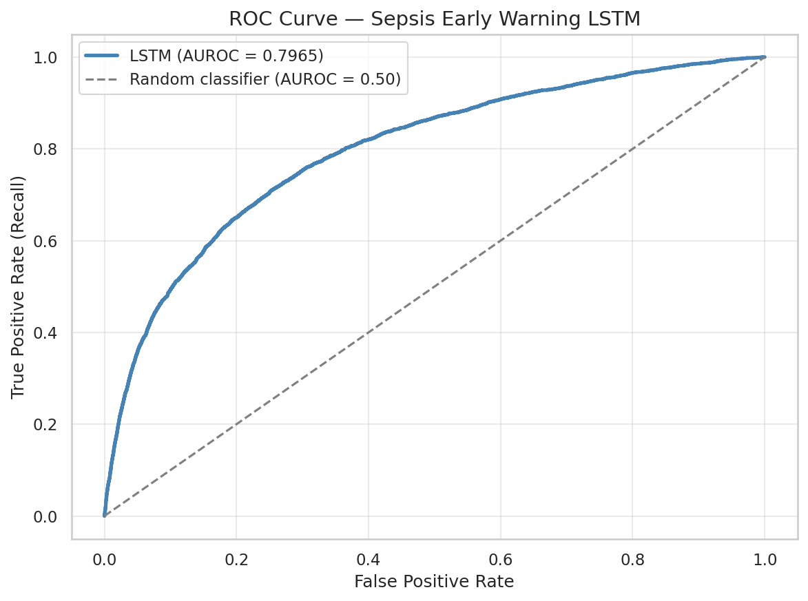

# AI-Based Early Prediction of Sepsis Using ICU Time-Series Data

LSTM-based early warning system that estimates the probability of sepsis
onset within the next 6 hours, using hourly ICU data.

## Dataset
PhysioNet/Computing in Cardiology Challenge 2019 (Kaggle version).
40,336 patients, 1,552,210 hourly records. Not included in this repo
due to size.

## Pipeline
1. Data exploration (class imbalance, missingness, patient-level stats)
2. Preprocessing (patient-wise forward fill, median imputation, scaling)
3. Sequence engineering (sliding windows per patient)
4. LSTM training (class imbalance handling)
5. Evaluation (AUROC, PR curve, recall)
6. Patient timeline risk visualisation

## Results
| Metric | Value |
|---|---|
| AUROC | 0.7965 |
| Recall | 0.6621 |
| Precision | 0.0553 |

## How to run
Notebooks were built in Google Colab. Paths assume
`/content/drive/MyDrive/sepsis_project/`. Run in order 01 to 06.
